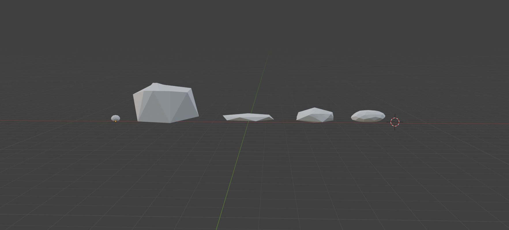
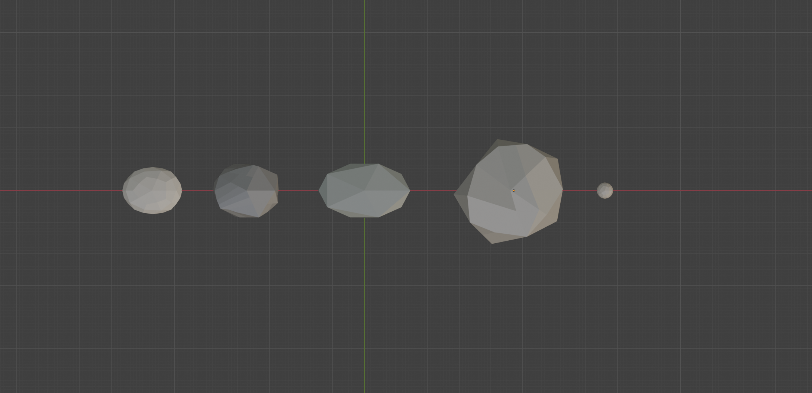
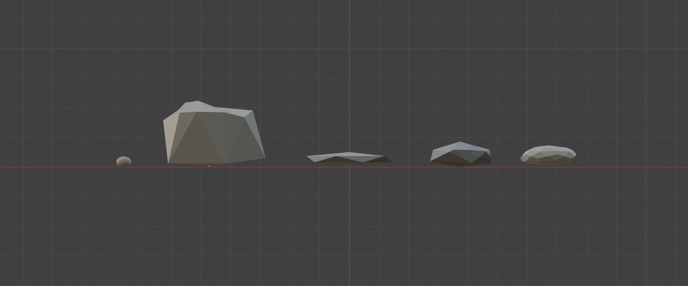

# 25.10.2026 – Modulare Low-Poly-Ufersteine

- **Projekt:** HP.3 / Minigame_HP.3 – Petrusilius' Schloss
- **Bereich:** Environment Art / Asset-Erstellung
- **Werkzeug:** Blender
- **Status:** Laufende Session; Zwischenstand dokumentiert
- **Integration:** Noch nicht als in Unity eingebaut oder getestet dokumentiert
- **Zeit:** Start, Ende und Dauer nicht erfasst

## Session_S – Ausgangslage und Fokus

### Ziel
Eine kleine modulare Steinbibliothek für das Teichufer entwickeln. Die Steine sollen später einen natürlicheren Übergang zwischen Teich und Wiese ermöglichen. Der Schwerpunkt liegt auf Silhouette, Formensprache und Varianz statt auf Detailtexturen.

### Gestalterische Referenz
*Alba: A Wildlife Adventure* dient als Inspiration für eine reduzierte, stilisierte Naturdarstellung. HP.3 soll daraus eine eigene visuelle Identität entwickeln: eigene Steinformen, Proportionen und Gruppierungen statt einer Übernahme konkreter Assets.

### Geplanter Umfang
Fünf zusammengehörige Low-Poly-Steine mit unterschiedlichen Grössen und Silhouetten. Die Wirkung im fertigen Teichufer muss später separat geprüft werden.

## Arbeitsschritte und Iterationen

### Formenfamilie
In Blender wurden fünf modulare Ufersteine erarbeitet:

1. Kleiner Kiesel als mögliche Füllform.
2. Kleiner kompakter Stein.
3. Flacher Plattenstein mit horizontaler Silhouette.
4. Mittlerer, rundlicher Uferstein.
5. Grösserer Akzent- beziehungsweise Findlingstein.

Die Grössenstaffelung bietet kleine Ergänzungen, mittlere Grundformen und einen grösseren Akzent. Unterschiedliche Silhouetten sollen spätere Gruppen abwechslungsreich machen, während die reduzierte Formensprache die Familie zusammenhält.

### Shading-Vergleich
Shade Smooth und Shade Flat wurden verglichen. Die Entscheidung fiel auf **Shade Flat**, um die facettierte Low-Poly-Formensprache und die einzelnen Flächen sichtbar zu halten.

### Weitere mögliche Iterationen – noch offen
- Beim grossen Stein prüfen, ob kleine asymmetrische Formänderungen die blockige Wirkung reduzieren.
- Kleine Kiesel später in Gruppen oder neben mittleren Steinen beurteilen.
- Gruppierungen und Grössenverhältnisse am Teichufer testen.

Diese Punkte sind nächste Prüfschritte und werden hier nicht als umgesetzt dargestellt.

## Entscheidungen

- **Modulare Bibliothek aus fünf Formen:** Ein überschaubarer Umfang ermöglicht verschiedene Kombinationen.
- **Shade Flat:** Unterstützt die gewählte facettierte Formensprache nach dem Vergleich mit Shade Smooth.
- **Silhouette und Grössenvariation priorisieren:** Die Lesbarkeit der Formen und ihre Kombinierbarkeit stehen im Mittelpunkt.
- **Eigene visuelle Identität:** Alba bleibt eine gestalterische Referenz; die konkrete Formgebung wird für HP.3 entwickelt.

## Screenshots und Nachweise

Die folgenden drei Original-Screenshots zeigen die fünf Ufersteine in Blender am 25.10.2026. Sie dokumentieren die Formenfamilie mit facettierter Oberfläche sowie die Silhouetten- und Grössenvariation.

### Gesamtansicht der Steinfamilie

*Perspektivische Übersicht: kleiner Kiesel, grosser Akzentstein, flacher Plattenstein und zwei kompaktere Formen. Unterschiedliche Höhen und Proportionen sind direkt vergleichbar. Original: Screenshot 2026-10-25 204125.png.*

### Draufsicht – Grundformen und Grössenvariation

*Die Draufsicht zeigt unterschiedlich breite, rundliche und unregelmässige Grundformen sowie die Grössenstaffelung innerhalb der Bibliothek. Original: Screenshot 2026-10-25 205218.png.*

### Frontansicht – Höhen und Silhouetten

*Die Frontansicht macht den Höhenkontrast zwischen Kiesel, Akzentstein und flacheren Uferformen sichtbar. Die einzelnen Flächen unterstützen die gewählte Low-Poly-Formensprache. Original: Screenshot 2026-10-25 205214.png.*

Die Bilder zeigen Blender-Zwischenstände. Ein direkter Shade-Flat-/Shade-Smooth-Vergleich ist darin nicht enthalten und kann bei Bedarf als zusätzlicher Beleg ergänzt werden. Ein späterer Unity-Screenshot gehört zur tatsächlich durchgeführten Integrationssession.

## Session_E – Zwischenstand, Abschluss noch offen

### Erreicht
- Fünf modulare Low-Poly-Ufersteine in Blender erarbeitet.
- Variation in Grösse, Proportion und Silhouette dokumentiert.
- Nach dem Shading-Vergleich Shade Flat gewählt.

### Grenzen des aktuellen Ergebnisses
Der aktuelle Nachweis betrifft die Asset-Entwicklung in Blender. Eine erfolgreiche Unity-Integration oder ein bereits verbesserter Übergang zwischen Teich und Wiese wird nicht behauptet. Die Wirkung im Spiel ist noch zu prüfen. Die Session ist noch nicht abschliessend ausgewertet.

### Nächste Schritte
- [x] Drei Screenshot-Belege aus Blender ergänzen.
- [ ] Formenfamilie und mögliche Korrekturen abschliessend prüfen.
- [ ] Export und Import in Unity in einer späteren Session durchführen und dokumentieren.
- [ ] Gruppierung, Massstab und Wirkung an Teich und Wiese im Spiel beurteilen.
- [ ] Session_E nach dem tatsächlichen Abschluss aktualisieren.

## Portfolio-Ergebnis

### Verwendbarer Text zum aktuellen Stand
> Für HP.3 entwickelte ich in Blender eine kleine modulare Bibliothek aus fünf Low-Poly-Ufersteinen. Durch unterschiedliche Silhouetten, Proportionen und Grössen entstand eine zusammengehörige Formenfamilie für die spätere Gestaltung des Teichufers. Nach einem Vergleich von Shade Smooth und Shade Flat entschied ich mich für Shade Flat. Ziel ist ein natürlicherer Übergang zwischen Teich und Wiese. Alba: A Wildlife Adventure diente als Inspiration für eine reduzierte Naturdarstellung, während die konkrete Formgebung eine eigene visuelle Identität verfolgt. Die Wirkung in Unity ist noch zu prüfen.

### Sichtbare Kompetenzen
Modulares Asset-Design, stilisierte Modellierung, bewusste Shading-Entscheidung und iterative Formbewertung. Die drei Blender-Screenshots belegen Formen-, Silhouetten- und Grössenvariation. Die spätere Prüfung im Spiel ergänzt den Portfolio-Nachweis.

[Zur Portfolio-Übersicht](README.md) · [Vorlage für weitere Sessions](TEMPLATE.md)
