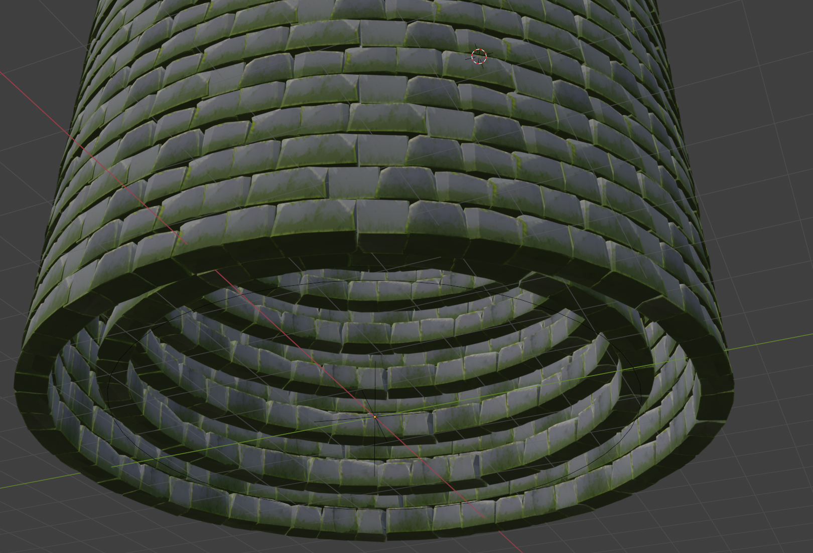
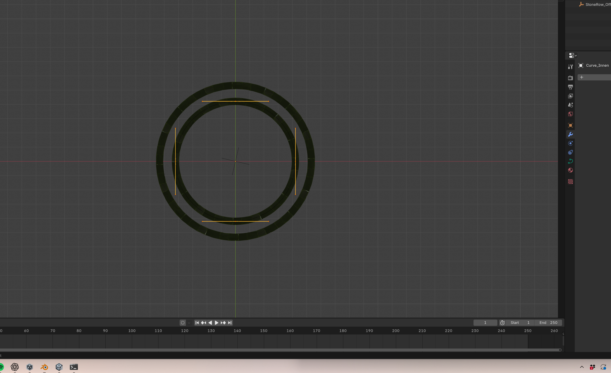
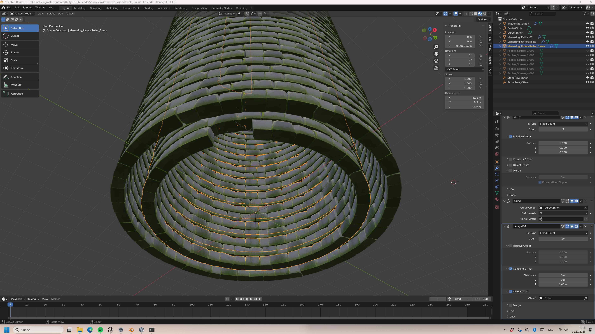
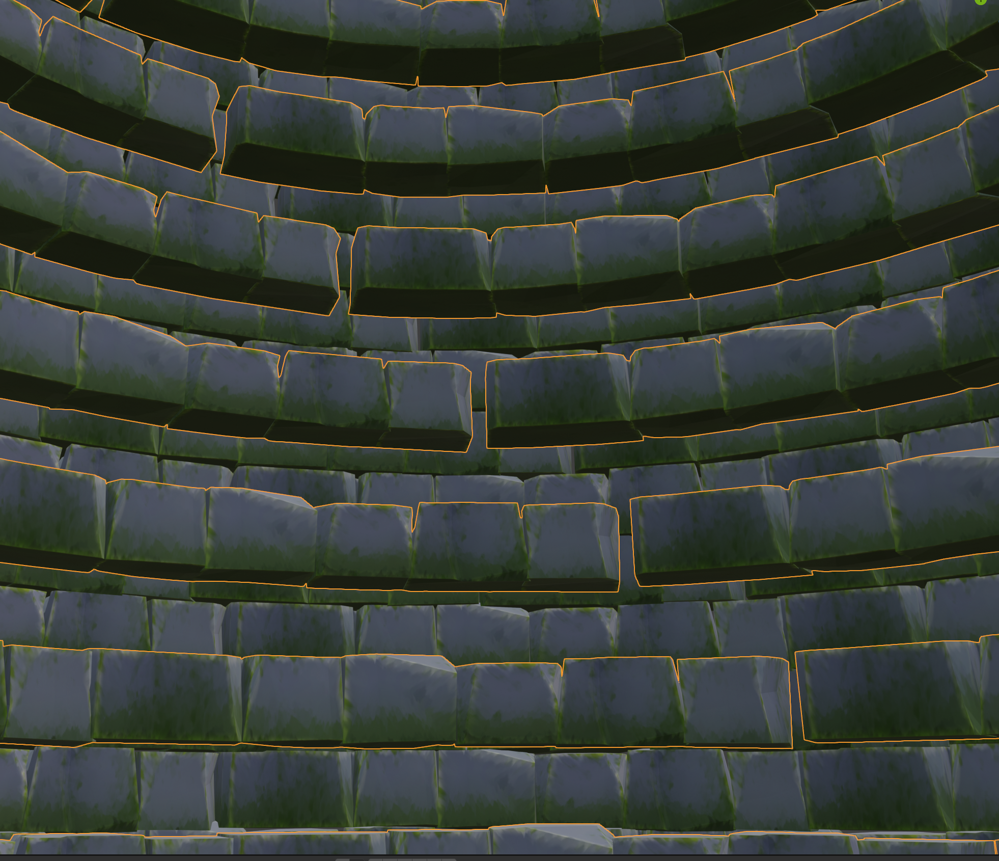
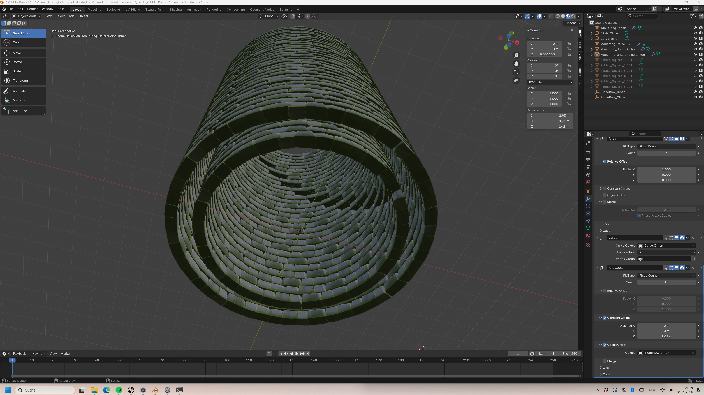

# 2026-11-01 – Modulares Mauerwerk für den Schlossturm

- **Projekt:** HP.3 / Petrusilius’ Schloss
- **Bereich:** Level Design – Environment & World Building
- **Werkzeug:** Blender 4.2.1
- **Stand:** Blender-Zwischenstand. Unity-Integration steht aus.

## Session_S – Ausgangslage und Fokus

Aus den Steinmodulen der äusseren Turmmauer sollte ein innerer Mauerring entstehen. Sein Radius sollte Raum für die geplante Wendeltreppe und die Spielerbewegung lassen.

## Arbeitsschritte und Iterationen

\

\

\

## Entscheidungen

- Die gleichen Steinmodule für beide Ringe verwenden, damit Innen- und Aussenmauer dieselbe Formensprache behalten.
- Den Innenring separat steuern, damit sein Radius an den Raumbedarf von Treppe und Spielfläche angepasst werden kann.
- Den Verputz zurückstellen, um die Gestaltung des Innenraums offenzuhalten, während der Mauerverband weiterentwickelt wird.

## Screenshots und Nachweise

\

\

\

\

\

## Session_E – Ergebnis und Reflexion

Die äussere Steinmauer war weitgehend ausgearbeitet und die Grundstruktur der Innenmauer stand. Die Wiederverwendung der Module ermöglichte einen zweiten Mauerring mit eigenem Radius. Die sichtbaren Unterbrüche zeigen, wo die Segmentübergänge weiter angepasst werden müssen. Mauerkern, Verputz und Unity-Integration waren offen. Die Begehbarkeit mit Wendeltreppe und Spielfigur ist noch zu prüfen.

## Portfolio-Ergebnis

Für Petrusilius’ Schlossturm habe ich aus denselben Steinmodulen einen äusseren und einen inneren Mauerverband aufgebaut. Die versetzten Steinreihen lockern das Wiederholungsmuster auf. Mit einer eigenen Kurve und einem angepassten Array konnte ich den Innenradius auf die geplante Wendeltreppe und den Bewegungsraum abstimmen. Die Session zeigt, wie modulares Environment Modeling und räumliches Level Design zusammenwirken. Die Prüfung der Laufwege im Spiel steht noch aus.

