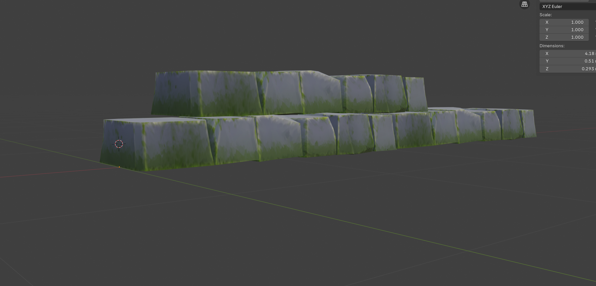
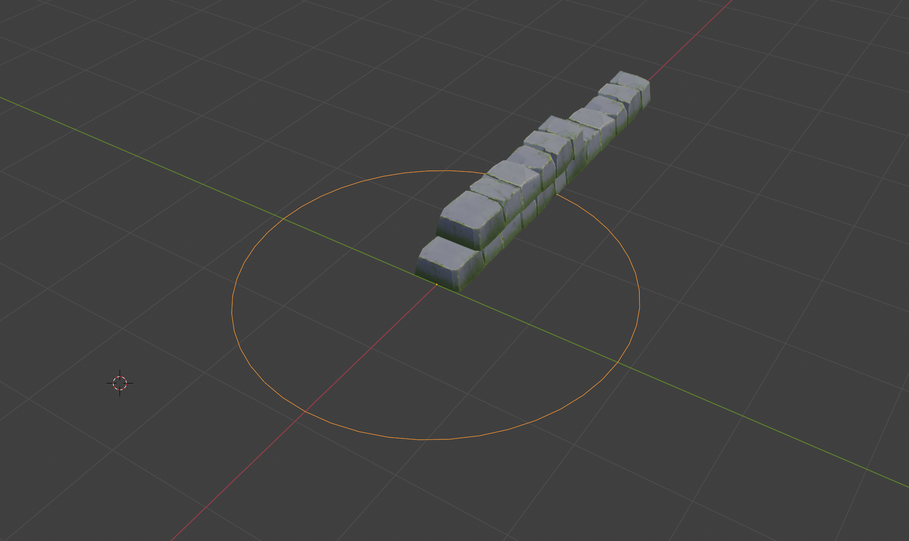
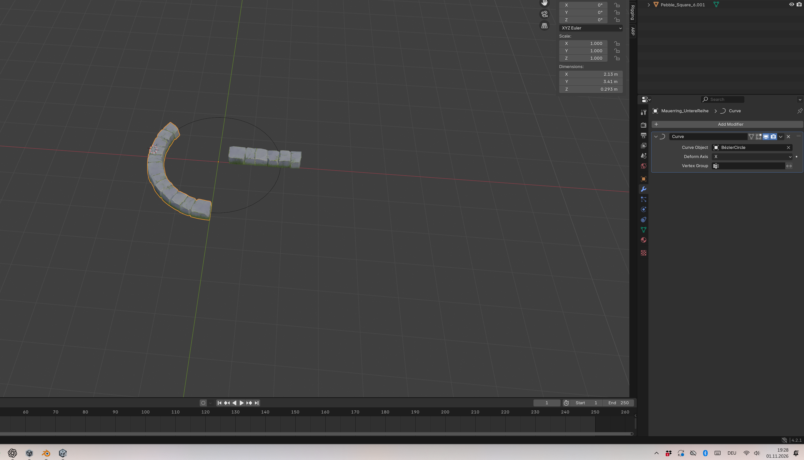
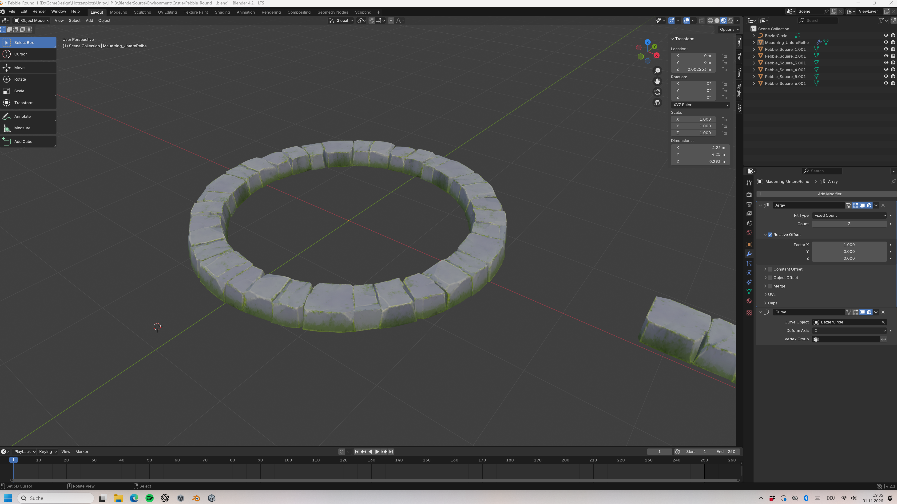
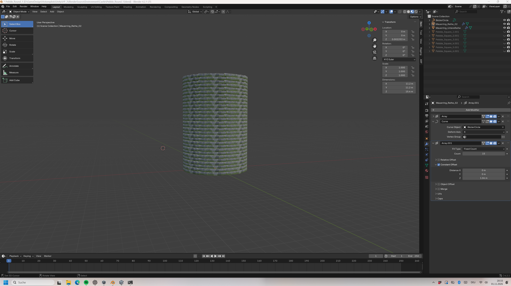

# 2026-11-01 – Modulares Mauerwerk für den Schlossturm

- **Projekt:** HP.3 / Petrusilius’ Schloss
- **Bereich:** Level Design – Environment & World Building
- **Werkzeug:** Blender 4.2.1
- **Stand:** Blender-Zwischenstand. Unity-Integration steht aus.

## Session_S – Ausgangslage und Fokus

Aus den Steinmodulen der äusseren Turmmauer sollte ein innerer Mauerring entstehen. Sein Radius sollte Raum für die geplante Wendeltreppe und die Spielerbewegung lassen.

## Arbeitsschritte und Iterationen

### 1. Ein Modul aus wenigen Steinen

*Wenige Steine bilden ein kurzes gerades Segment aus zwei versetzten Reihen. An diesem Modul lässt sich der Fugenverlauf vor der Vervielfältigung beurteilen.*

### 2. Vom geraden Segment zum Kreisbogen

*Die gerade Steinreihe liegt am kreisförmigen Kurvenpfad.*

*Der erste gebogene Abschnitt zeigt die wiederholte Steinreihe entlang des Kurvenpfads.*

Das Array wiederholt das kurze Segment. Der Curve-Modifier führt die Wiederholungen entlang der Kurve. Der Teilbogen macht sichtbar, wie sich die Steinreihe an die Rundung anpasst.

### 3. Den Ring schliessen und die Aussenmauer stapeln

*Die wiederholte Steinreihe bildet einen vollständigen Ring. Daneben ist ein gerades Segment sichtbar.*

*Übereinanderliegende Steinringe bilden den zylindrischen Turmmantel.*

Die Reihen wurden gegeneinander gedreht. So liegen die Fugen versetzt und das Wiederholungsmuster tritt weniger deutlich hervor.

*Die Untersicht zeigt die gestapelten Steinreihen der Aussenmauer und die Öffnung zum Innenraum.*

### 4. Das Modul für den kleineren Innenradius wiederverwenden

*Die Draufsicht zeigt beide Ringe. Der Innenradius begrenzt den verfügbaren Raum für die geplante Wendeltreppe und die Spielerbewegung.*

Für die Innenmauer wurden dieselben Steinmodule wiederverwendet. Sie erhielt mit `Curve_Innen` und `StoneRow_Innen` einen eigenen Kurvenpfad und eine eigene Steinreihe. Das Array wurde an den kleineren Umfang angepasst. Danach kam mit `Mauerring_UntereReihe_Innen` die zweite Innenreihe hinzu.

*Der Blick von unten zeigt die innenliegenden Steinreihen und die Öffnung für die geplante Treppe.*

*Die Blender-Ansicht zeigt den Turm mit eingeblendeten Modifier-Einstellungen. Array, Curve und Object Offset gehören zum modularen Aufbau.*

### 5. Die Segmentübergänge prüfen

*Die Nahaufnahme zeigt verbleibende Unterbrüche zwischen einzelnen Steinsegmenten.*

Die Kontrolle aus mehreren Blickwinkeln zeigte, welche Übergänge nach der Anpassung an den Innenradius noch bearbeitet werden müssen.

## Entscheidungen

- Die gleichen Steinmodule für beide Ringe verwenden, damit Innen- und Aussenmauer dieselbe Formensprache behalten.
- Den Innenring separat steuern, damit sein Radius an den Raumbedarf von Treppe und Spielfläche angepasst werden kann.
- Den Verputz zurückstellen, um die Gestaltung des Innenraums offenzuhalten, während der Mauerverband weiterentwickelt wird.

## Session_E – Ergebnis und Reflexion

Die äussere Steinmauer war weitgehend ausgearbeitet und die Grundstruktur der Innenmauer stand. Die Wiederverwendung der Module ermöglichte einen zweiten Mauerring mit eigenem Radius. Die sichtbaren Unterbrüche zeigen, wo die Segmentübergänge weiter angepasst werden müssen. Mauerkern, Verputz und Unity-Integration waren offen. Die Begehbarkeit mit Wendeltreppe und Spielfigur ist noch zu prüfen.

## Portfolio-Ergebnis

Für Petrusilius’ Schlossturm habe ich aus denselben Steinmodulen einen äusseren und einen inneren Mauerverband aufgebaut. Die versetzten Steinreihen lockern das Wiederholungsmuster auf. Mit einer eigenen Kurve und einem angepassten Array konnte ich den Innenradius auf die geplante Wendeltreppe und den Bewegungsraum abstimmen. Die Session zeigt, wie modulares Environment Modeling und räumliches Level Design zusammenwirken. Die Prüfung der Laufwege im Spiel steht noch aus.
