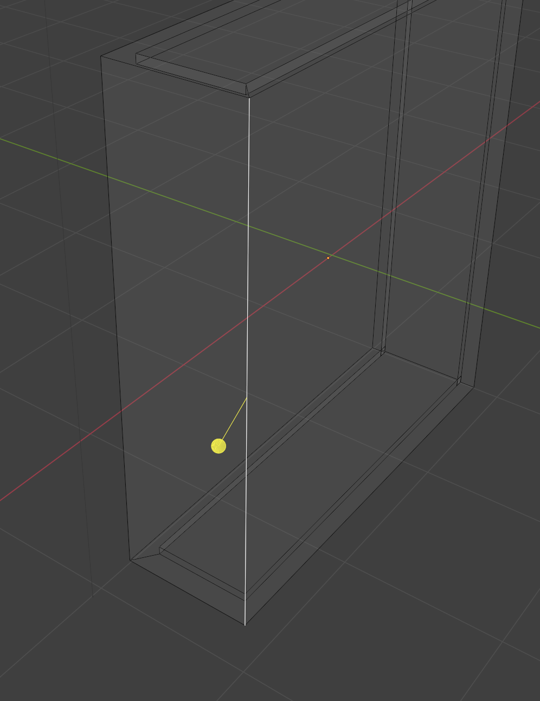
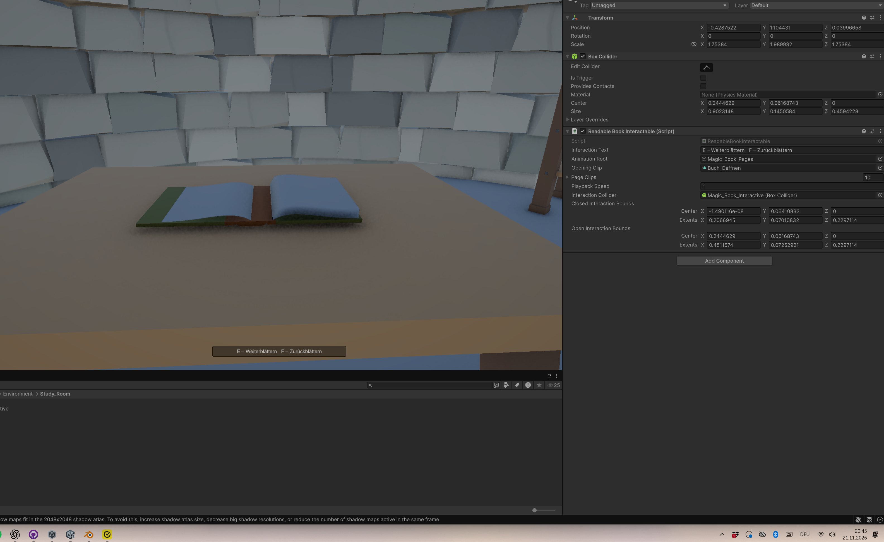
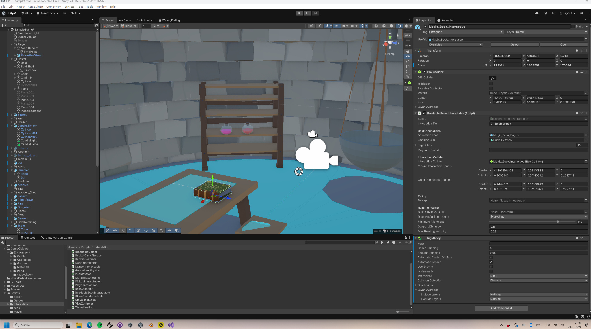
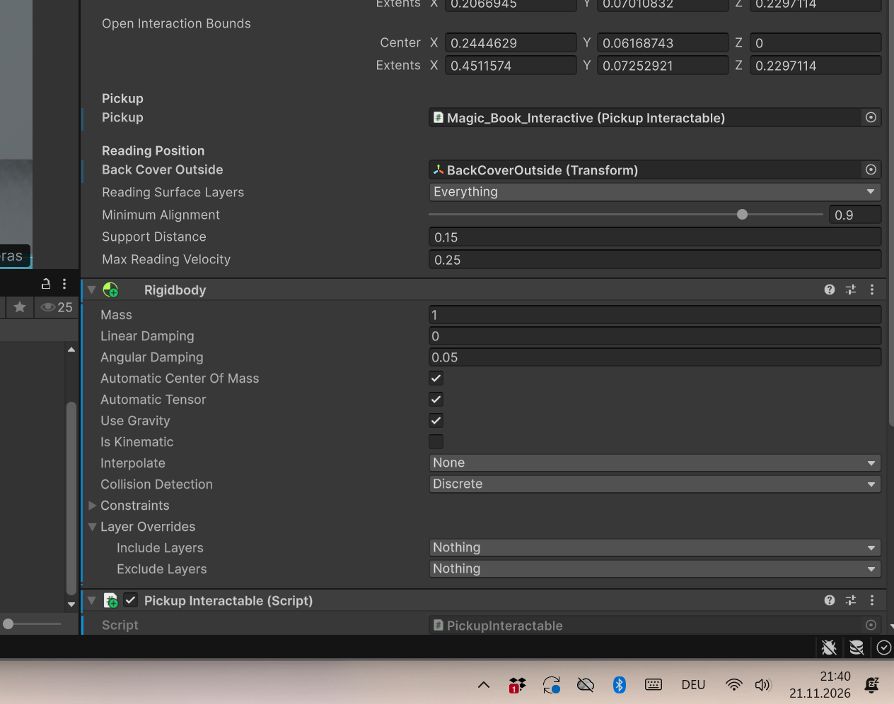

# 21.11.2026 – Buch der kleinen Wunder

- **Projekt:** HP.3 · Petrusilius’ Schloss
- **Bereich:** Prop Design, Animation, World Building und Interaktion
- **Werkzeuge:** Blender, Unity 6
- **Status:** Session abgeschlossen · Pickup-Leseablauf im Play Mode noch offen
- **Zeit:** 21.11.2026, 19:40–21:40 Uhr (2 Stunden laut Zeitrapport). Die Rückschau umfasst auch frühere Arbeiten seit dem 5. November.
- **Integrationsstand:** Texturiertes Buch, FBX und Prefab in Unity. Tischinteraktion in ihrer früheren Fassung getestet. Physik und lageabhängiges Lesen in der späteren Fassung eingerichtet.

## Session_S – Ausgangslage und Fokus

Petrusilius soll im Studierzimmer ein konkretes Objekt vorfinden, in dem Zauberformeln ihren Platz haben. Das Buch sollte im Raum als Zauberbuch erkennbar sein und sich glaubwürdig öffnen und seitenweise lesen lassen. Die Zauber selbst bilden einen eigenen Entwicklungsschritt. Die [Konzeptnotizen](../Concepts/Magic.md) sammeln unter anderem Levitation, Feuer, Wachstum, Reparatur und Verwandlung als Ideen.

## Arbeitsschritte und Iterationen

### 5. November – Gestaltung und erstes Blender-Modell

Die Coverstudien gingen von einer detailreicheren Vorlage zu einer flachen Low-Poly-Gestaltung mit matten Farbflächen über. Die Art Direction von *Alba: A Wildlife Adventure* war eine lose Referenz für vereinfachte Formen. Der dreizeilige Titel bekam die Mitte, Stern und Keimling rahmten ihn ein, Ranken blieben am Rand. Olivgrün, Ocker und der braune Rücken mit goldfarbenen Bändern gaben dem Buch eine wiedererkennbare Farb- und Formensprache. In der Coverphase wurde zuerst die Komposition beurteilt. Der Commit sichert das Blender-Modell sowie Farb-, Normal- und Höhenkarten aus der Texturarbeit. [Commit vom 5. November](https://github.com/mateus-marty-dev/HP3/commit/4ed4f7a)

*Blender, 5. November. Die markierte Aussenkante stammt aus der Frage zur gleichmässigen Abrundung.*

### 12.–15. November – Scharnier, Rücken und erste Seitenbewegung

Am 12. November kam eine separate Blender-Datei für die Seiten hinzu. Beim Öffnen des Frontdeckels entstanden sichtbare Abstände am U-förmigen Rücken und an den Zierbändern. Der Frontdeckel erhielt einen eigenen Drehpunkt, während der Rücken der Bewegung mit einer verformbaren Geometrie folgt. Im Wochenrückblick ist für den 14. November eine erste 180°-Umblätterbewegung festgehalten, bei der die Seitenform noch in Arbeit war. Der Commit vom 15. November enthält die weiterbearbeitete Seitendatei und Sicherungsstände aus der Arbeit am Hinterdeckel. [12. November](https://github.com/mateus-marty-dev/HP3/commit/0341310) · [15. November](https://github.com/mateus-marty-dev/HP3/commit/f33f4b7)

### 21. November – Zehn Seiten, realistischer Falz und Unity-Export

1. **Stapelreihenfolge.** Die zuerst umgeblätterte Seite wurde unten im Zielstapel abgelegt. Jede weitere Seite kommt darüber. Animierte Shape Keys formten den Falz in der jeweiligen Ablageposition.
2. **Öffnung und Seitenbewegung.** Die Animation beginnt geschlossen. Bis Frame 24 öffnet sich nur der Frontdeckel, während die Seiten auf dem Hinterdeckel liegen bleiben. Erst danach setzt das Blättern ein. Die Seitenwölbung wurde anhand der Seitenansichten überarbeitet und doppelte oder unbenutzte Blender-Actions wurden bereinigt.
3. **Import.** Der Export überträgt die Verformung von Rücken und Seiten in Blend Shapes. Das FBX enthält einen Öffnungsclip und zehn einzelne Seitenclips. Einzelne Clips erlauben es, die Buchbewegung pro Eingabe auszulösen und rückwärts abzuspielen. [Erster FBX-Stand](https://github.com/mateus-marty-dev/HP3/commit/b8b9cc5) · [Exportskript](../../BlenderSource/Study_Room/export_magic_book_unity.py)
4. **Bindekante.** Im Unity-Spielbild fiel auf, dass die beiden gewölbten Stapel in der Mitte auseinanderlagen. Beide Stapel wurden an derselben Mittellinie des Buchrückens ausgerichtet. Die Aussenkanten blieben beim Öffnen über dem jeweiligen Deckel. Die Korrektur wurde gespeichert, erneut exportiert und laut Entwicklungsprotokoll beim Vor- und Rückwärtsblättern in Unity geprüft. [Korrekturskript des gesicherten Arbeitsstands](../../Backups/MagicBook_Zentrierung_20261121_2048/center_binding.py)

*Original-Prüfrender aus der Seitenform-Iteration. Frame 0 zeigt den geschlossenen Rücken, Frame 24 den geöffneten Deckel bei unverändertem Seitenstapel und Frame 54 den Stapel auf der Gegenseite. Die Bilder entstanden vor der späteren Zentrierung.*

*Unity, 20:45 Uhr. Der E/F-Hinweis ist sichtbar. Die Lücke zwischen den Stapeln war der Anlass für die Korrektur der Bindekante.*

### 21. November – Vom Tischbuch zum aufnehmbaren Gegenstand

Das Buch wurde als Prefab auf dem Tisch im Studierzimmer platziert. In der zunächst getesteten Fassung öffnete **E** das Buch und blätterte weiter, **F** blätterte zurück und schloss es am Anfang. Während einer Bewegung wurden weitere Eingaben gesperrt. Der Entwicklungs-Chat dokumentiert direkte E/F-Tests im Play Mode, separate Prüfungen aller zehn Seiten und den erneuten Blättertest nach der Bindekorrektur. Das [Editor-Prüfskript](../../Assets/Scripts/Editor/MagicBookSetup.cs) hält den damaligen Ablauf fest.

Mit der anschliessenden Pickup-Erweiterung änderte sich die Belegung. **E** nimmt das Buch auf oder legt es ab. **F / Linksklick** öffnet oder blättert weiter, **Q / Rechtsklick** blättert zurück oder schliesst am Anfang. Die Lesefreigabe prüft, ob das Buch abgelegt ist, sich langsam genug bewegt und mit dem Rückdeckel auf einer tragenden Fläche liegt. Der Transform **BackCoverOutside** liefert die Ausrichtung des Rückdeckels. [Interaktionsstand im Commit](https://github.com/mateus-marty-dev/HP3/commit/c3807a0) · [Eingaben](../../Assets/Scripts/Interaktion/PlayerInteraction.cs) · [Lesefreigabe](../../Assets/Scripts/Interaktion/ReadableBookInteractable.cs)

*Unity-Editor, 21:32 Uhr. Cover und Rücken sind in der Szene sichtbar. Der Inspector zeigt den Öffnungsclip und zehn Seitenclips. Die Felder für Pickup und Rückdeckel sind hier noch leer.*

*Unity-Editor, gegen 21:40 Uhr. Pickup und BackCoverOutside sind zugewiesen, die Schwerkraft ist aktiviert. Der Inspector dokumentiert die Einrichtung. Ob die Sensorachse richtig ausgerichtet ist und die Eingaben im Zusammenspiel funktionieren, bleibt zu prüfen.*

## Session_E – Ergebnis und Reflexion

### Erreicht

Das Buch hat eine eigenständige Gestaltung, einen animierten Rücken und zehn einzeln blätterbare Seiten. [Blender-Datei](../../BlenderSource/Study_Room/Magic_Book_Pages.blend), [Unity-FBX](../../Assets/GameObjects/Environment/Study_Room/Magic_Book_Pages.fbx) und [Prefab](../../Assets/GameObjects/Environment/Study_Room/Magic_Book_Interactive.prefab) sind im Repository vorhanden. Der frühere Tischablauf wurde im Play Mode geprüft. Für die spätere Pickup-Fassung sind Umsetzung und Inspector-Einrichtung belegt.

### Offen

- [ ] Im aktuellen Unity-Stand mit **E** aufnehmen, ablegen und die Lage auf dem Rückdeckel prüfen. Haltepunkt, Spieler-Collider und Sensorachse bei Bedarf kontrollieren.
- [ ] Nach dem Ablegen öffnen, vor- und zurückblättern und schliessen. Lesesperre bei falscher Lage, während Bewegung und in der Hand prüfen.
- [ ] Regalplatz mit Snap-Position bleibt als Idee offen. Zauberformeln und Zauberwirkungen sind als eigener Spielablauf noch zu belegen.

### Designentscheidungen und Erkenntnisse

- **Prop Design und World Building.** Der dekorative Titel und die wiederkehrenden Pflanzen- und Sternmotive geben dem Buch eine Identität. Die Platzierung auf dem Tisch verbindet es mit Petrusilius’ Arbeitsraum. Ob Titel und Symbole aus der Spielkamera lesbar sind, lässt sich mit einer Nahaufnahme und einer Aufnahme aus normaler Interaktionsdistanz beurteilen.
- **Animation.** Ein weicher Rücken, eine gemeinsame Bindekante und die Reihenfolge der Stapel verkaufen dieselbe Bewegung als gebundenes Papier. Die Seitenansicht machte den Falz überprüfbar. Das Spielbild zeigte danach das Auseinanderklaffen, das bei der isolierten Bewegung weniger auffiel.
- **Interaktionsdesign.** Getrennte Eingaben für Tragen und Lesen geben zwei Aktionen am selben Objekt einen festen Platz. Die Physikbedingung soll zum räumlichen Umgang mit dem Buch passen. Ob die Leseposition für Spielende zuverlässig erreichbar und verständlich ist, entscheidet der nächste Play-Mode-Test.

## Portfolio-Ergebnis

Das «Buch der kleinen Wunder» wurde für Petrusilius’ Studierzimmer als handhabbares Low-Poly-Requisit entwickelt. Die Arbeit verbindet Covergestaltung, Buchmechanik in Blender und eine zustandsabhängige Interaktion in Unity. Die Seitenform-Studien und das Spielbild zeigen, wie Stapelreihenfolge und Bindekante schrittweise korrigiert wurden. Für eine Case Study auf ArtStation oder der Portfolio-Website bietet sich die Folge Cover im Raum → Öffnung im Seitenprofil → Falzkorrektur → kurzer Gameplay-Clip an. Den Clip nach dem vollständigen Test der Pickup-Fassung aufnehmen.

**Quellen der Rückschau.** Die Entwicklungsnotizen stammen aus «Zaubersystem entwickeln», «Zauberbuch-Ansichten ausschneiden», «Blender-Buchdeckel reparieren», «HP.3 Wochenstatus» und «Zeitübersicht klären». Die Bildbelege stammen aus Originalanhängen, dem lokalen Screenshot-Ordner und den Prüfrendern im Repository. Ein separater Ordner «Galerie» war an den durchsuchten lokalen Orten nicht auffindbar.
